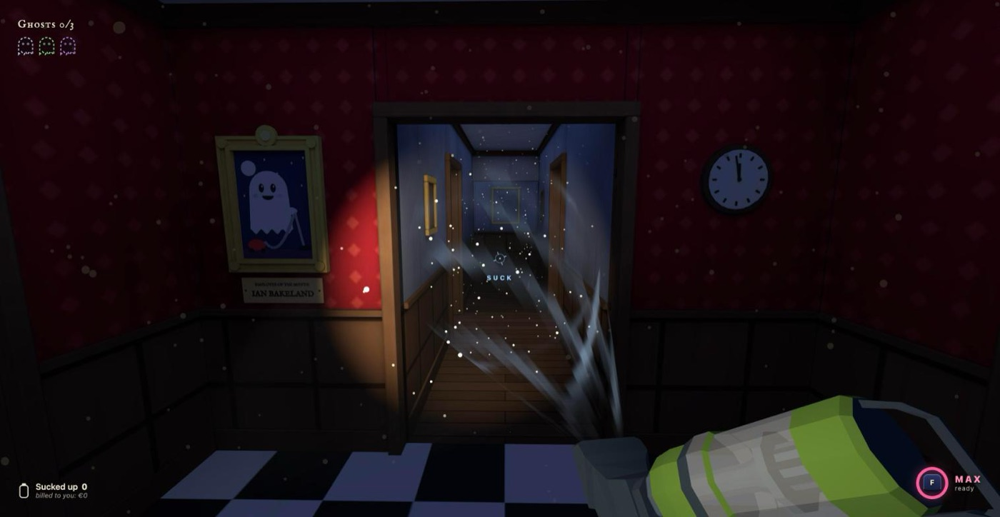
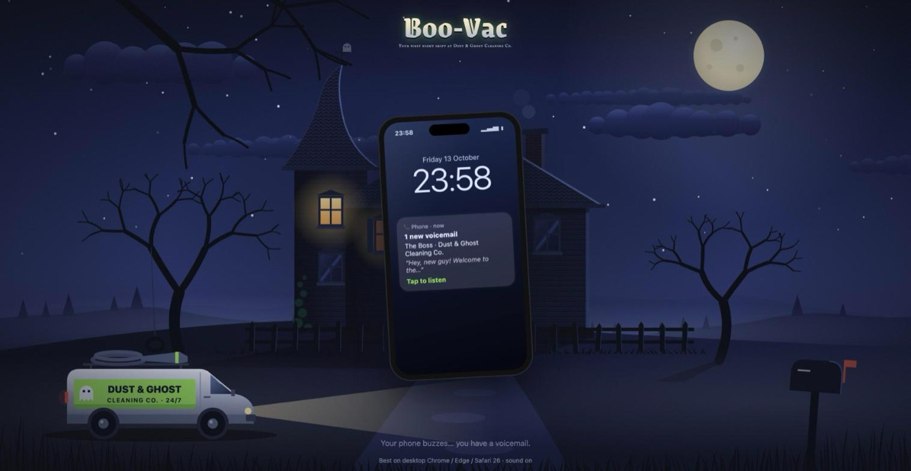
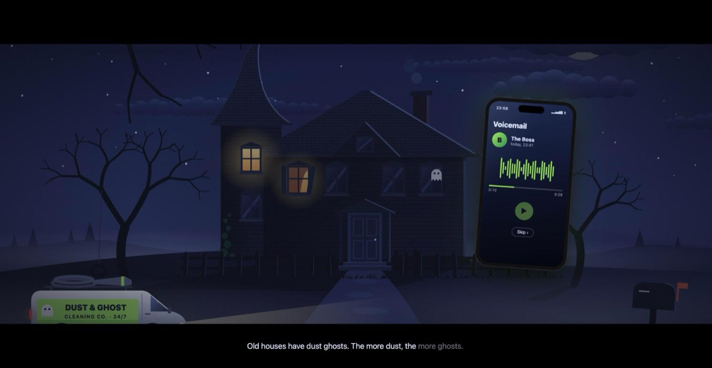
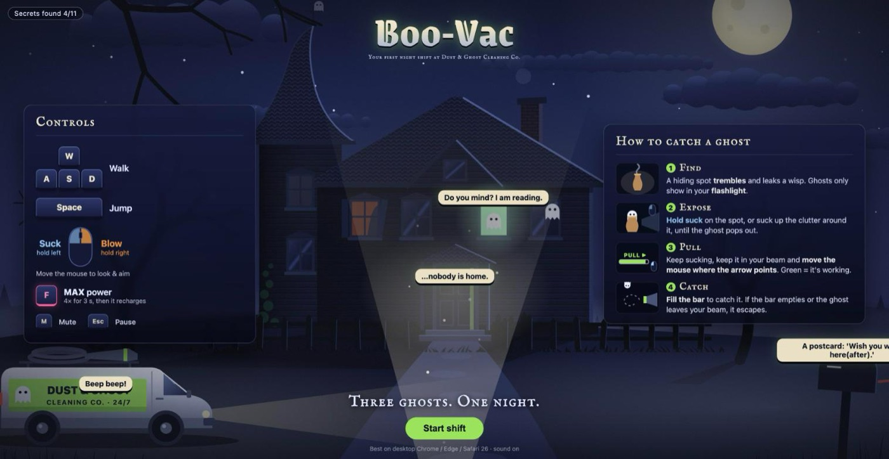
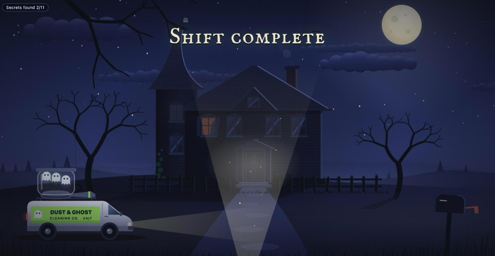
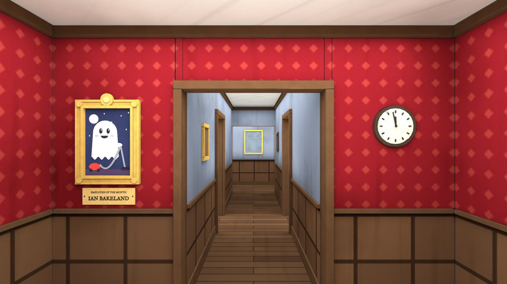

<div align="center">

# Boo-Vac

**A first-person ghost-cleaning game in the browser, built with Three.js `WebGPURenderer` and WGSL.**

Search a dark house with your flashlight, vacuum the clutter, and pull three ghosts into your vacuum.

[](https://threejs.org)
[](https://www.w3.org/TR/WGSL/)
[](https://rapier.rs)
[](https://docs.swmansion.com/TypeGPU/)
[](https://huggingface.co/onnx-community/Kokoro-82M-v1.0-ONNX)
[](https://vite.dev)

**[▶ Play it live](https://ianbakeland.com/Boo-Vac/)**

<br>








</div>

---

## What is this?

You're the new night-shift cleaner at **Dust & Ghost Cleaning Co.**, a dodgy company that also handles "light paranormal nuisance". Your first job: an old house at midnight, with a flashlight and an overpowered vacuum.

The twist: ghosts live in dust and clutter, so cleaning and ghost hunting are the same thing. Find a hiding spot that trembles, vacuum the clutter around it until the ghost pops out, then win a tug-of-war by moving the mouse against the ghost's pull. Catch all three and you get… an invoice for everything you sucked up.

## The assignment

| Asked | Where |
|---|---|
| Shadertoy fragment shader ported to WebGPU (WGSL) in Three.js `WebGPURenderer` | [Ether by nimitz](https://www.shadertoy.com/view/MsjSW3) → the ghost aura (`js/shaders/ether/`), plus [VCR distortion by ryk](https://www.shadertoy.com/view/ldjGzV) → the VHS filter (`js/shaders/vhs/`) |
| Shader responds to user interaction | The aura only shows in your flashlight beam, smears toward the nozzle while you suck, and stretches with the tug-of-war; the VHS filter gets worse the harder you pull |
| Interaction beyond looking around | Walk, jump, suck, blow, MAX, unclog the vacuum, tug-of-war against the ghost; before and after the shift: a voicemail on your phone and a clickable villa with 11 secrets |
| Physics | Rapier: player controller, props sucked in a spiral, captured, blown back out, furniture moved by MAX, books thrown by a ghost |
| Multiple shaders | 2 Shadertoy ports + suction cone, flashlight beam, room flashlight lighting, compute dust |
| Additional WebGPU libraries | TypeGPU: the dust's glitter. Kokoro (kokoro-js / Transformers.js): the boss's voice, generated live on the GPU |
| Own Blender model + baking | The house (the whole level), baked in Cycles into `public/textures/baked.jpg` |
| Controlling Blender animations | Three animated ghost models, their clips driven per game state with an `AnimationMixer` |

## Features

- **A flashlight is all you have.** The house is dark blue moonlight. Your beam reveals the colors, makes the dust glitter, and is the only way to see a ghost.
- **Suck and blow.** Hold left to suck (props spiral into the nozzle), right to blow them away. Suck up 5 things and the hose jams: blow to shoot them back out.
- **MAX power.** Press F for 3 seconds of ×4 force that even drags the furniture around.
- **Three ghosts, three personalities.** Dusty giggles when it gets away, the Librarian throws books at you, and Granny Clock is fast and has to be beaten twice. Catch them in any order.
- **Tug-of-war.** Move the mouse against the ghost's pull to fill the meter. The screen turns into a worn VHS tape the harder you pull.
- **A voicemail from the boss.** The intro is a lock screen and a voicemail app, with subtitles that light up word by word. The boss's voice is an AI model running on your GPU.
- **A villa you can poke.** Before and after the shift, click the van, the windows, the moon, the mailbox… 11 secrets, each with its own sound and line.
- **An invoice at the end.** Your pay, minus €12 for every item of the client's you sucked up and €50 for every ghost that got away, with a star rating.
- **No sound files.** Every sound and the music (a drone, a creepy music box, a heartbeat during the tug) is generated live with the Web Audio API.

## 🎮 How to play

| Input | Action |
|---|---|
| Click "Start shift" | Start (locks the mouse, turns on sound) |
| Mouse | Look / aim. During the tug-of-war: move it against the ghost's pull |
| W A S D | Walk |
| Space | Jump |
| Left mouse (hold) | Suck |
| Right mouse (hold) | Blow (also unclogs the vacuum) |
| F | MAX: 3 s of extra strong suction that also moves furniture (recharges) |
| Esc | Pause |
| M | Mute |

**Before the shift:** tap the notification on your phone, press ▶ to hear the boss's voicemail (or Skip), then *Start shift*. Meanwhile, and again in the ending, click things around the villa.

> **Tip:** best on desktop Chrome / Edge / Safari 26, with sound on. On a first visit (or in incognito) the boss's voice still has to download: give it a minute before you press ▶, otherwise he talks with the browser's robot voice.

## 🧠 How it works

1. **The intro** (`js/intro.js`) is one SVG drawing animated with CSS. While it plays, the house, the ghosts and the boss's voice load in the background.
2. **The room** is lit by our own spotlight shader, so it stays dark until your flashlight hits it. Each frame, `draw()` reads your input, moves you with a Rapier character controller, spins the vacuum's `power` up or down with gsap, and applies one shared suction formula to the props (Rapier) and the dust (a compute shader).
3. **A hiding spot** fills up as you suck at it. At full exposure the ghost comes out: its animated model plus the Ether shader on a billboard in front of it.
4. **The tug-of-war** starts when the ghost is in your beam and in your suction cone. Pull the right way to fill the meter, and it's caught; let the meter empty or lose it from your beam, and it escapes to another hiding spot.
5. **The ending** (`js/outro.js`) turns the lights on, pulls the camera back out of the front door, drops the three ghosts into a jar on the van, and slides in the invoice.

### Shadertoy ports

Both are WGSL files (`js/shaders/<name>/fragment.wgsl`), imported with `?raw` and wrapped with `wgslFn`, like in the course. The Shadertoy URL is in the header of each file.

- **Ether → ghost aura** (`js/shaders/ether/`): the original 6-step raymarch, drawn on a billboard in front of the ghost model (`MeshBasicNodeMaterial`, additive). Added inputs make it interactive: `tint` (one color per ghost), `visibility` (computed in JS from the flashlight cone: outside the beam the ghost is invisible) and `stretch` (the smoke smears toward the nozzle while you suck, more as the tug meter fills, fully at capture).
- **VCR distortion → VHS filter** (`js/shaders/vhs/`, `js/postfx.js`): post-processing over the whole frame with `THREE.RenderPipeline`. The rendered scene is the shader's `iChannel0` (the same texture node for texture + sampler, the course trick); the original noise texture is replaced by a hash. It fades in when a tug-of-war starts, and the grain, stripes, wobble and roll get stronger as the meter fills. At amount 0 the scene passes through untouched. Only with real WebGPU.

### Own shaders

- **Suction cone** (`js/shaders/suction/`): swirling air in front of the nozzle, procedural noise scrolled and twisted along a cone; blue-white inward when sucking, orange outward when blowing. Everything is multiplied by the vacuum's `power`.
- **Flashlight beam** (`js/shaders/beam/`): a faint "volumetric" cone, so the light is visible in the dusty air.
- **Room flashlight lighting** (`js/shaders/flashlight/`): the house and furniture are lit by our own spotlight math (`albedo × (moonlight ambient + lamp × cone × facing × distance falloff)`).
- **Dust particles** (`js/shaders/dust/update.wgsl`, `js/objects/dust.js`): a compute shader (TSL storage buffers) moves the dust with the same suction formula as the physics (pull + tangent swirl + drag + per-speck speed limit). The glitter is written with **TypeGPU**: a JavaScript function marked `'use gpu'` (turned into WGSL by `unplugin-typegpu`) that reads Three.js values with `fromTSL`, adds a 3D Perlin-noise twinkle from `@typegpu/noise`, and is plugged in as the dust's color with `toTSL`.

### The level: own Blender model + baking

`public/models/house.glb`, modelled in Blender (`blender/house.blend`): an old house of 12 × 10 m with seven rooms (the hall where you start, a pantry, a study, the living room, the library, a corridor and a long gallery). Each room has its own wallpaper, wainscoting and floor; the hall has a portrait of the "Employee of the month", Ian Bakeland.



- **Baking:** the whole house is lit evenly in Blender and baked (Cycles, Combined) into one 4096 × 4096 texture, `public/textures/baked.jpg`, on one shared UV map.
- **In the game** (`js/objects/room.js`): loaded like the course's bake project (`TextureLoader`, `flipY = false`, `colorSpace = SRGBColorSpace`), and the bake is the albedo of the room flashlight shader.
- **Empty on purpose:** all furniture and props are placed in code (`LAYOUT` in `js/config.js`), so they can be physics bodies and hiding spots.

### Physics (Rapier)

`js/physics.js`: a [Rapier](https://rapier.rs) world (WebAssembly) stepped at a fixed 60 Hz.

- **Player:** a kinematic character controller with a capsule, colliding with a trimesh of the house, so walls and furniture are solid and you can jump.
- **Props** (books, cups, candles, pillows…): dynamic bodies. Each step the vacuum applies an impulse from one shared formula, `suctionForce()` (pull toward the nozzle + a swirl around its axis, inside a cone, fading with distance). Small props that reach the nozzle are removed from the world and counted.
- **Clogging:** the 5th item jams the hose. Blowing shoots the stuck items back out, each as a new Rapier body.
- **MAX** moves the heavy furniture (table, chair, vase), and **the Librarian** throws books at you with a Rapier impulse.

### The intro and the ending

- **The voicemail** (`js/intro.js`): a lock screen and a voicemail app in HTML/CSS. The voicemail system ("You have one new message") is the browser's speech synthesis on purpose: a flat robot voice. The boss's lines come with subtitles that light up word by word, and the villa reacts to each line (mist, a cloud over the moon, the headlights, the lights going out at "Good luck!").
- **The boss's voice: Kokoro on WebGPU** (`js/voice.js`): Kokoro-82M, a small text-to-speech AI model, runs in the browser on the GPU with `kokoro-js` (built on Transformers.js). It downloads (326 MB, once, then it's cached) while the opening film plays, generates every line of the boss, then frees the GPU for the game. Not ready yet? The hint says "Loading the voicemail…" for at most 15 s; after that, and without WebGPU, the boss uses the browser's speech synthesis.
- **The clickable villa** (`js/outside.js`): every clickable thing has `data-poke="<name>"` in the SVG and reacts with a sound, an animation (Web Animations API) and a line in a speech bubble (`OUTSIDE` in `js/config.js`). The van honks (a real car horn: two clipped sawtooth notes), the dark windows show their ghost, the moon howls and calls lightning… In the ending the ghosts are in the jar, so the van and the windows say other things.

## Tech stack

| | |
|---|---|
| **3D & shaders** | [Three.js](https://threejs.org) r186 (`three/webgpu`, `three/tsl`), `WebGPURenderer`, WGSL via `wgslFn`, `RenderPipeline` post FX |
| **More WebGPU** | [TypeGPU](https://docs.swmansion.com/TypeGPU/) (`@typegpu/three`, `@typegpu/noise`, `unplugin-typegpu`), [kokoro-js](https://github.com/hexgrad/kokoro) (Transformers.js + ONNX Runtime on WebGPU) |
| **Physics** | [Rapier](https://rapier.rs) (`@dimforge/rapier3d-compat`, WebAssembly) |
| **Animation** | [gsap](https://gsap.com), `AnimationMixer` for the ghost models, CSS + Web Animations for the intro and the ending |
| **Sound** | Web Audio API (everything generated), Web Speech API (the voicemail system) |
| **Build & deploy** | [Vite](https://vite.dev), GitHub Actions → GitHub Pages |

## Getting started

### Prerequisites

- [Node.js](https://nodejs.org/) and npm
- A browser with WebGPU (Chrome, Edge, Safari 26). Without it the game falls back to WebGL2, without the dust, the VHS filter and the Kokoro voice.

### Run it

```bash
git clone https://github.com/IanBakeland/Boo-Vac.git
cd Boo-Vac
npm install
npm run dev
```

`npm run build` makes the site in `dist/`, and `npm run preview` serves it. Every push to `main` deploys to GitHub Pages.

Add `?debug` to the URL for an FPS counter, collider lines and debug keys: **G** a ghost comes out, **P** drop the props, **O** play the ending.

## 📁 Project structure

```
index.html              the canvas + every screen (intro villa SVG, phone, HUD, pause, invoice)
css/style.css
js/
  script.js             init(), draw(), input, the game state machine
  config.js             every tunable number, the level layout and all texts
  intro.js              the opening film + the voicemail
  outro.js              the ending + the invoice
  outside.js            the clickable villa
  voice.js              the boss's voice (Kokoro on WebGPU)
  audio.js              all sound and music (Web Audio)
  physics.js            the Rapier world, suctionForce()
  postfx.js             the VHS filter (RenderPipeline)
  objects/              room, props, vacuum, flashlight, ghost, dust
  shaders/              ether, vhs, suction, beam, flashlight, dust (WGSL)
public/
  models/               the house, furniture, props, the vacuum, three ghosts (GLB)
  textures/baked.jpg    the house's bake
blender/                house.blend (the level) and a render of the hall
docs/screenshots/       the screenshots in this README
```

## Credits

| Asset | Author | License | Link |
|---|---|---|---|
| Ether (shader) | nimitz | CC BY-NC-SA 3.0 | https://www.shadertoy.com/view/MsjSW3 |
| VCR distortion (shader) | ryk | CC BY-NC-SA 4.0 | https://www.shadertoy.com/view/ldjGzV |
| Kokoro-82M (voice model) | hexgrad | Apache-2.0 | https://huggingface.co/onnx-community/Kokoro-82M-v1.0-ONNX |
| kokoro-js (library) | hexgrad, Xenova | Apache-2.0 | https://github.com/hexgrad/kokoro |
| Grenze Gotisch (title font) | Omnibus-Type | SIL OFL 1.1 | https://fonts.google.com/specimen/Grenze+Gotisch |
| IM Fell English SC (heading font) | Igino Marini | SIL OFL 1.1 | https://fonts.google.com/specimen/IM+Fell+English+SC |
| Ghost (animated, Dusty) | Quaternius | CC0 | https://poly.pizza/m/Iip30bDHmu |
| Hywirl (animated, The Librarian) | Quaternius | CC0 | https://poly.pizza/m/zjr7CmWGER |
| Alien (animated, Granny Clock) | Quaternius | CC0 | https://poly.pizza/m/sUTLXji0aL |
| Vacuum Cleaner | Zoe XR | CC BY | https://poly.pizza/m/1_kdZRnuCo8 |
| House (the level, baked) | Ian Bakeland (Blender) | own work | `blender/house.blend` |
| Bookcase with Books | Quaternius | CC0 | https://poly.pizza/m/tACDGJ4CGW |
| Grandfathers Clock | CreativeTrio | CC0 | https://poly.pizza/m/09YKIkFZnA |
| Chair | Quaternius | CC0 | https://poly.pizza/m/zMmKNm8w4a |
| Small Table | Quaternius | CC0 | https://poly.pizza/m/rAEBvfb1FT |
| Rug | Quaternius | CC0 | https://poly.pizza/m/7H5qKjuxVY |
| Chandelier | CreativeTrio | CC0 | https://poly.pizza/m/RPLTkXHOOM |
| Tall Vase | Jarlan Perez | CC BY | https://poly.pizza/m/52xZtzRG244 |
| Books | CreativeTrio | CC0 | https://poly.pizza/m/dxt7dETAy9 |
| Book Stack | Danni Bittman | CC BY | https://poly.pizza/m/1WggoIFq8tx |
| Bottle | Quaternius | CC0 | https://poly.pizza/m/FAHsHFXfTf |
| Cup | Kenney | CC0 | https://poly.pizza/m/aSF8ANEIsX |
| Candle | Nick Slough | CC BY | https://poly.pizza/m/HFpLq6iqKu |
| Pillow | Poly by Google | CC BY | https://poly.pizza/m/f60emm1Xkas |
| House plant | Poly by Google | CC BY | https://poly.pizza/m/3qh9saogdJd |

## About

Boo-Vac is a solo student project for Creative Development at DEVINE. The ghost-vacuuming mechanic is inspired by Luigi's Mansion; no Nintendo names, characters or assets are used. The ported shaders keep their CC BY-NC-SA licenses, and every asset keeps the license in the table above.
